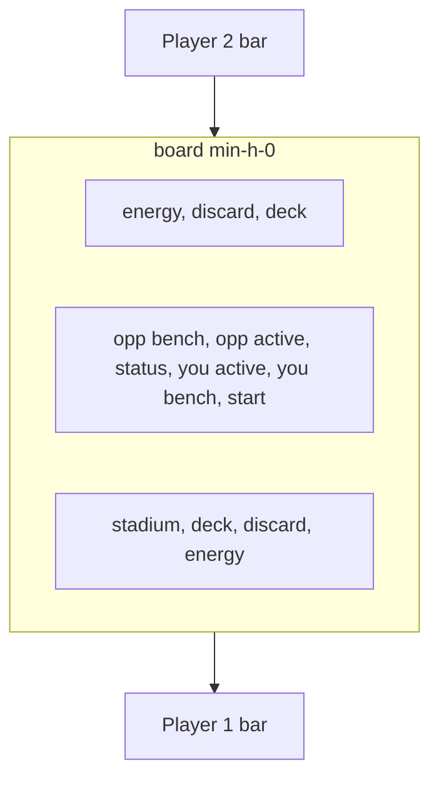

# หน้า 01-opening

ทำใน [E:\pototype figma](E:\pototype figma) ไม่แตะ [E:\pokemon-tcg-pocket-sim](E:\pokemon-tcg-pocket-sim)

โฟลเดอร์นี้มีแค่ `.cursor/mcp.json` ต้องสกาฟโฟลด์ Next.js 16 (App Router, TypeScript, Tailwind) ลงตรงนี้ โดยไม่ลบ `.cursor`

สแต็กตามที่ขอ ลงเท่าที่ใช้ในหน้านี้

- shadcn เฉพาะ `Button` (`components.json`, `cn`, `class-variance-authority`, `@radix-ui/react-slot`)
- `motion` สำหรับกดปุ่ม `เริ่ม` (`whileTap`) และปิดเมื่อ `prefers-reduced-motion`
- `lucide-react` สำหรับ FAB: `Ellipsis`, `Undo2`
- Figtree ผ่าน `next/font/google` ใน `app/layout.tsx`

เฟรม `01-opening` (`58:116`) คือบอร์ดว่างก่อนเริ่มเกม พื้นดำ แถบบนแดงของ Player 2 แถบล่างน้ำเงินของ Player 1 จุดรางวัลว่าง 3 จุด สล็อต Active / Bench / Stadium / Deck / Discard / Energy กลางจอมีข้อความ `เกมยังไม่เริ่ม` กับปุ่ม `เริ่ม` FAB อยู่ฝั่งล่างซ้ายของกลางบอร์ด ยังไม่ผูกเอนจิน ไม่ทำ glow

## ไฟล์

- [app/page.tsx](E:\pototype figma\app\page.tsx) เรนเดอร์บอร์ด เป็นหน้าแรกของแอปนี้ เฟรมถัดไปค่อยเพิ่ม route ทีหลัง
- [components/opening-board.tsx](E:\pototype figma\components\opening-board.tsx) เลย์เอาต์ทั้งจอ
- [app/globals.css](E:\pototype figma\app\globals.css) โทเคนสีของเฟรมนี้

## เลย์เอาต์

โครงเต็ม `h-dvh overflow-hidden` ไม่สกอร์ล

- แถบผู้เล่นสูงคงที่ประมาณ 42px กริด 3 คอลัมน์ `minmax(4.5rem,1fr) minmax(0,22rem) minmax(4.5rem,1fr)` สัดส่วนใกล้ Figma (ข้างละ ~769, กลาง ~367 จากบอร์ด 1905)
- สล็อตการ์ด `aspect-[5/7]` ขนาดด้วย `min()` จากความกว้างคอลัมน์และความสูงที่เหลือ เพื่อให้แถว active สองแถวบวก bench สองแถวอยู่ใน `1fr` เสมอ
- จอกว้างต่ำกว่า 720px: รางซ้ายขวาแคบลง สล็อตกลางย่อตาม ไม่เปลี่ยนลำดับโซน
- สีตาม Figma: พื้น `#000` สล็อต `#121212` เส้น `#333` Active ฝั่งตรงข้ามเส้น `#FF5A5A` ฝั่งเรา `#5AA9FF` แถบบน `linear-gradient(90deg,#140808,#3A1212)` แถบล่าง `linear-gradient(90deg,#12305A,#08121F)` เส้นกลางจอไล่ `#000 → #2F5FA8 → #000` ปุ่มเริ่มพื้นขาว เส้นไล่ `#7894ED → #3AE4EF` ข้อความ `#8A8A8A`
- ปุ่ม `เริ่ม` วางขวาของข้อความ `เกมยังไม่เริ่ม` บนเส้นกลาง FAB สองปุ่มซ้อนกันฝั่งล่างของคอลัมน์กลาง ยังกดแล้วไม่ไปไหน
- หลังการ์ด Deck/Discard ดึงจาก image fill ของโหนด `58:136` ด้วย `download_figma_images` ไปที่ `public/opening/card-back.png` ถ้าดึงไม่ได้ใช้พื้น `#121212` แล้วค่อยใส่รูปทีหลัง

## เช็ค

เปิดหน้าแรกบนเดสก์ท็อปและจอแคบ ต้องเห็นโซนครบ ไม่มีสกอร์ลทั้งหน้า ข้อความไทยตรงเฟรม ปุ่มเริ่มกดแล้วหดเล็กน้อย
